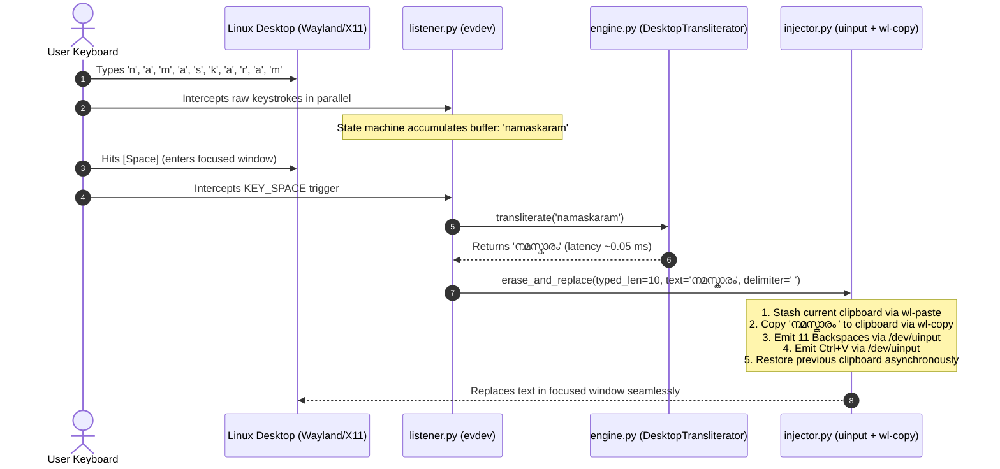

# MangoKeys Typer: Technical Architecture & Maintainer Guide

> **System-Wide Linux Desktop Live Transliteration Daemon**  
> *Targeted at Fedora KDE Plasma / GNOME (Wayland & X11)*

This document provides a comprehensive technical breakdown of the `typer/` subsystem for developers, maintainers, and autonomous agents extending or debugging MangoKeys desktop transliteration.

---

## 1. System Mission & Core Philosophy

### The Goal
Provide an instantaneous, system-wide transliteration daemon where a user types Manglish (e.g. `namaskaram`) into **any** desktop application (browsers, Slack, terminal, text editors, Discord, IDEs) and upon pressing **`Space`** or **`Enter`**, the typed Latin characters are erased and replaced inline with the corresponding Malayalam Unicode characters (e.g. `നമസ്കാരം `).

### Invariant Architectural Rules
1. **Zero Permanent System Changes**:
   - Never write to `/etc/`, `/usr/`, or user dotfiles (`~/.bashrc`, `~/.config`).
   - Never register persistent `systemd` user or root services.
   - Never alter the user's active XKB keyboard layouts, IBus, or Fcitx daemon settings.
2. **Terminal-Bound Lifecycle**:
   - The daemon lives exclusively inside the terminal process that ran `sudo python3 typer/run.py`.
   - The moment the user presses `Ctrl+C` or closes the terminal, the kernel automatically destroys the virtual keyboard device, unhooks event descriptors, and restores normal keyboard operation instantly.
3. **Pure Python Self-Containment**:
   - All code lives strictly within `typer/`.
   - Does not touch or modify files in `model/`, `runtime/`, or root configuration scripts.

---

## 2. Directory Structure & Component Roles

```
typer/
├── __init__.py         # Package entrypoint exposing public interfaces
├── config.py           # Keycodes, debounce timings, thresholds, and search paths
├── engine.py           # DesktopTransliterator: RuleEngine baseline & ONNX bridge
├── listener.py         # evdev keyboard discovery and typing state machine
├── injector.py         # uinput keystroke erasure and atomic Unicode clipboard injection
├── run.py              # CLI dashboard, ANSI streaming logs, and signal handling
├── test_typer.py       # 12-stage automated test suite covering all modules
├── README.md           # End-user quickstart and troubleshooting guide
└── README_Typer.md     # This comprehensive technical reference
```

---

## 3. End-to-End Execution Flow



---

## 4. Deep Dive: Component Architectures

### 4.1 Configuration & Keycodes (`typer/config.py`)
Encapsulates runtime tunables inside the `@dataclass TyperConfig`:
* **Hotkeys**:
  - `KEY_RIGHTALT` (Code `100`): Single-tap toggle between Manglish mode and Pass-Through English mode.
  - `KEY_ESC` (Code `1`): Instantly clears the word buffer without triggering transliteration.
  - `KEY_BACKSPACE` (Code `14`): Pops the last character from buffer.
  - `KEY_SPACE` (Code `57`) & `KEY_ENTER` (Code `28`): Delimiter keys triggering replacement.
* **Debounce & Burst Delays**:
  - `BACKSPACE_DELAY = 0.002s`: Delay between consecutive virtual backspaces to allow the Wayland compositor event queue to process each keyup/keydown cleanly.
  - `PASTE_DELAY = 0.015s`: Small window after copying text to clipboard before triggering `Ctrl+V`.
  - `RESTORE_CLIPBOARD_DELAY = 0.20s`: Time after `Ctrl+V` before restoring previous clipboard content in a background worker thread.
* **`ERASE_DELIMITER = True`**:
  - In non-exclusive (passive) keyboard listening on modern Linux desktops, when the user presses `Space`, the focused window registers the space character simultaneously.
  - To prevent leaving an orphaned space or requiring a separate virtual space event, `erase_and_replace` deletes `len(word) + 1` characters (erasing the space + the Latin word) and pastes `Malayalam + " "`. This is atomic and eliminates race conditions.

### 4.2 Transliteration Engine Interface (`typer/engine.py`)
`DesktopTransliterator` provides a hybrid architecture:
1. **RuleEngine Baseline (`model.src.rules.RuleEngine`)**:
   - Zero external dependencies.
   - Operates in ~0.05 milliseconds per word.
   - Generates top Malayalam candidate plus ordered alternatives.
2. **Graceful Neural ONNX Upgrade**:
   - Checks candidate directories: `runs/demo/onnx-int8` and `runs/ml_mini/onnx`.
   - Checks for `encoder.onnx`, `decoder.onnx`, and `tokenizer.json`.
   - If present and if `onnxruntime` and `numpy` are installed, loads `runtime.python.transliterator.Transliterator`.
   - If missing, gracefully falls back to `RuleEngine` without crashing or throwing errors.
3. **Data Return Contract**:
   ```python
   @dataclass
   class TransliterationResult:
       input_text: str
       top_candidate: str
       candidates: list[str]
       latency_ms: float
       engine_name: str  # "rules" | "onnx"
   ```

### 4.3 Input Interception & State Machine (`typer/listener.py`)
* **Hardware Device Discovery (`find_keyboard_devices()`)**:
  - Scans all `/dev/input/event*` devices using `evdev.list_devices()`.
  - Filters devices by checking capability bitmasks:
    - Must report `ecodes.EV_KEY`.
    - Must possess alphanumeric keys (counts `KEY_A` through `KEY_Z` >= 20, plus Space and Enter).
    - Ignores mice, power switches, and virtual keyboards matching `mangokeys` or `uinput` to avoid feedback loops.
  - Ranks physical keyboards: AT Translated internal keyboards first, USB keyboards second.
* **Permission Detection (`KeyboardPermissionError`)**:
  - If permissions are missing, outputs explicit, copy-pasteable resolution steps (`sudo python3 typer/run.py` or `sudo usermod -aG input $USER`).
* **Typing State Machine (`KeyboardWatcher`)**:
  - `TypingState`: Holds character buffer, `shift_pressed`, `caps_lock`, and `manglish_mode`.
  - Supports uppercase capitalization (`shift_pressed ^ caps_lock`) which maps to Malayalam retroflex consonants (`T -> ട`, `D -> ഡ`, `N -> ണ`, `L -> ള`, `R -> റ`).
  - Separates pure event logic (`process_key(code, value)`) from `evdev` I/O, allowing 100% unit-test coverage without mock input hardware.

### 4.4 Keystroke Erasure & Unicode Injector (`typer/injector.py`)
* **The Problem with Virtual Keyboards for Indic Scripts**:
  - Virtual input drivers (`uinput`) cannot emit arbitrary Malayalam Unicode code points directly using physical keycodes because standard keyboard layouts have no keycodes for complex Indic glyphs, vowel signs, and conjunct viramas.
* **The Solution: Atomic Clipboard Injection**:
  1. **Stash**: Saves the current clipboard contents via `wl-paste -n` (Wayland) or `xclip` / `xsel` (X11).
  2. **Stage**: Writes `<malayalam_text><delimiter>` to the clipboard via `wl-copy -n`.
  3. **Erase**: Emits $N$ `KEY_BACKSPACE` down/up strokes through `evdev.UInput`.
  4. **Paste**: Emits `Ctrl+V` through `evdev.UInput`.
  5. **Restore**: Launches a non-blocking background `threading.Timer` to restore the user's previous clipboard content after 200ms. If another word is converted before the timer expires, the timer resets cleanly.

### 4.5 CLI Entry Point & Dashboard (`typer/run.py`)
* **ANSI Live Streaming Logs**:
  - Header banner displays active engine, mode, and shortcuts.
  - Each word conversion prints timestamps, original input, Malayalam output, latency in milliseconds, and alternative candidates.
  - State changes (`Right-Alt` toggle, `Esc` buffer cancel) emit distinct color-coded badges and audio bell chimes (`\a`).
* **Signal Handlers (`SIGINT` & `SIGTERM`)**:
  - Hooked via Python `signal` module.
  - When interrupted (`Ctrl+C`):
    - Sets `stop_event` to cleanly terminate selector loops.
    - Closes `UInput` virtual device.
    - Closes `evdev.InputDevice`.
    - Displays a structured session statistics card (total words converted, average latency).

---

## 5. Verification & Testing

The module includes an automated test suite (`typer/test_typer.py`) that can be executed directly:

```bash
# Run test suite
python3 typer/run.py --test

# Run dry-run simulation preview without hardware access
python3 typer/run.py --dry-run
```

### Verified Test Cases
1. `test_engine_initialization_defaults_to_rules`: Verifies fallback to `RuleEngine`.
2. `test_transliterate_basic_words`: Verifies accurate transliteration (`namaskaram`, `ente`).
3. `test_transliterate_empty_string`: Verifies empty input resilience.
4. `test_transliterate_candidates_limit`: Verifies `n_best` slicing.
5. `test_basic_word_typing_and_space_trigger`: Verifies word accumulation and delimiter firing.
6. `test_backspace_pops_character`: Verifies buffer character deletion.
7. `test_esc_clears_buffer_without_triggering`: Verifies buffer clearing on Esc.
8. `test_right_alt_toggles_manglish_mode`: Verifies single-tap toggle and English pass-through.
9. `test_shift_and_caps_lock`: Verifies retroflex capital letter preservation (`Ta`).
10. `test_non_word_keys_reset_buffer`: Verifies cursor movement keys reset buffer.
11. `test_clipboard_operations`: Verifies system clipboard read/write roundtrip.
12. `test_injector_creation_and_close`: Verifies clean creation and teardown of `/dev/uinput`.

---

## 6. Guide for Future Maintainers & Autonomous Agents

When modifying or updating `typer/`, follow these recommendations:

### A. Updating Transliteration Models
- If you train a new ONNX model, place `encoder.onnx`, `decoder.onnx`, and `tokenizer.json` in `runs/ml_mini/onnx/` or pass `--model-dir <path>` and `--tokenizer <path>`.
- `DesktopTransliterator` in `typer/engine.py` will automatically detect and load the neural model.

### B. Adjusting Debounce or Timing Parameters
- If running on low-spec hardware or a heavily loaded Wayland compositor where backspaces are missed, increase `BACKSPACE_DELAY` in `typer/config.py` from `0.002` to `0.005`.
- If applications paste stale clipboard content, increase `PASTE_DELAY` from `0.015` to `0.030`.

### C. Adding Custom Hotkeys
- Add the desired evdev keycode to `TyperConfig` in `typer/config.py`.
- Handle the key event inside `KeyboardWatcher.process_key()` in `typer/listener.py`.
- Keep event logic pure and write a corresponding unit test in `typer/test_typer.py`.

### D. Security & Permissions Reference
- Access to `/dev/input/event*` requires either `root` privilege (`sudo`) or membership in the `input` group (`sudo usermod -aG input $USER`).
- Access to `/dev/uinput` is granted to local logged-in users on modern systemd-based Linux desktops via `uaccess` ACLs. If running headless or in containers, verify permissions using `getfacl /dev/uinput`.
